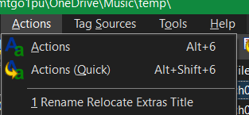

# Audiobook Processor

Turns books in `Music\Audiobooks` into tagged, chaptered `.m4b` files in `Music\Plex_audiobooks`, laid out for Plex.
Inspired by [seanap/Plex-Audiobook-Guide](https://github.com/seanap/Plex-Audiobook-Guide).

Paths are hard-coded for this PC (`C:\Users\kruse\OneDrive\Music`, work dir `C:\Audiobook_Work`). Sources are never changed.

## Setup

```console
winget install --id Gyan.FFmpeg -e --source winget
py -3.11 -m venv C:\Audiobook_Work\.venv
C:\Audiobook_Work\.venv\Scripts\python -m pip install --use-feature=truststore mutagen truststore
```

The `.cmd` wrappers run each script with that venv. Norton flags new scripts; add them and the venv's `python.exe` to its exclusions.

## Tools

| Tool | What it does |
|---|---|
| `audiobook.cmd <book> [book...]` | One book (folder or file) → one `.m4b`. Pick the Audible match (`*` = runtime matches), then it joins, chapters, tags and files it. |
| `process_rest.cmd` | Runs `audiobook.py` on every book in `Audiobooks` not yet in Plex. Splits multi-book folders. |
| `rechapter.cmd` | Rebuilds Plex books that have no chapters from their source. Old files go to `Music\_replaced\`. |
| `author_photos.py` | Adds `artist.jpg` (from Audible via Audnexus) to each author/series folder lacking one. |
| `run_manual.sh` | One-off batch of hand-matched books (example of `--asin` / manual-tag runs). |
| `rename_chapters.py`, `make_chapter_list.py` | Legacy manual method (rename files, build an ffmpeg `list.txt`). |

### audiobook.cmd

```console
.\audiobook.cmd "..\Audiobooks\Book A" "..\Audiobooks\Book B"   # pick matches first, then runs unattended
.\audiobook.cmd "<book>" --asin B00XXXXXXX --yes                 # no prompts
.\audiobook.cmd "<book>" --title "T" --author "A" --year 2013 --series "S" --part 1   # not on Audible
```

Options: `--dry-run`, `--query`, `--asin`, `--series`, `--author`, `--year`, `--part`, `--narrator`,
`--chapters auto|files|audible`, `--bitrate`, `--overwrite`, `--yes`. See `-h`.

- AAC sources are copied without re-encoding; mp3 is encoded to AAC at source bitrate (max 128k).
- Chapters, in order: the source's real chapters → file boundaries if one file per Audible chapter → Audible chapter
  names snapped to the longest nearby pause (used if runtime is within 30s, or within 5% with ≥80% of breaks on long pauses) → one per file.
- Tags match mp3tag's Audible source. Output: `Plex_audiobooks\Author\Series\Year - Title [Series N]\` with cover, `desc.txt`, `reader.txt`.
- Each finished book is logged to `processed_log.csv`.

### process_rest.cmd

```console
.\process_rest.cmd --list              # what's left / done / not doable
.\process_rest.cmd --only "Mitch Rapp" # filter by path text
.\process_rest.cmd --auto              # no prompts; runtime matches only
.\process_rest.cmd --dry-run
```

Skips books in `processed_log.csv` or whose title is already in Plex. Ctrl+C while picking processes what's picked so far.
OneDrive online-only files are made online-only again afterwards (`--keep-downloaded` to keep them).

### rechapter.cmd

```console
.\rechapter.cmd --list
.\rechapter.cmd --only "Wheel of Time"
```

Uses each book's own tags so its folder and name stay the same. Source must match runtime within 1%.
Results in `rechapter_report.csv`.

## Manual fallback (mp3tag)

Use the original (preconfigured) mp3tag: Audible USA tag source , then the rename/move action .
